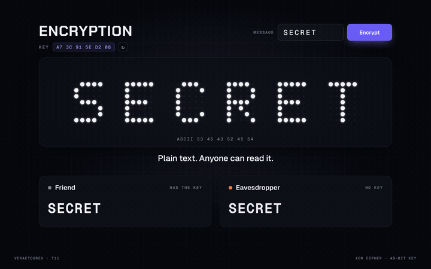

# Cipher Key

**A key turns SECRET into noise.**



**Live demo:** [veraetogrex-portfolio.github.io/cipher-key](https://veraetogrex-portfolio.github.io/cipher-key/) · **Mockup:** [full-screen version](https://veraetogrex-portfolio.github.io/cipher-key/mockup/cipher-key.html)

A key sweeps across the message and every letter bursts into its ciphertext byte. The eavesdropper only ever gets hex; the friend with the same key sweeps it back into the word.

## Use it

Three files, no build step, no dependencies, no web fonts:

```
index.html   markup
style.css    styles and keyframes
script.js    behaviour
```

Download the repo and open `index.html`, or copy the three files into your project.

## Try it

- Type up to 8 characters (A–Z, 0–9, `! ? . -`) and press **Encrypt**, then **Decrypt**, then **Again**.
- `↻` next to the key makes a new random 48-bit key.

## Make it yours

The cipher is XOR with a random key: a teaching toy that shows what a key does, not something to protect real data with. For real data use `crypto.subtle` (AES-GCM). Set a fixed key with `data-key="A7 3C 91 5E D2 08"` on `#cipher`. Colours are CSS custom properties at the top of `style.css`.

## What's in `mockup/`

The full 1440×900 screen this component was shot in for the reel:

- `mockup/cipher-key.html` — interactive. `D` plays the demo, `R` resets.
- `mockup/cipher-key.autoplay.html` — the scripted loop the reel was recorded from.
- URL flags: `?frame` puts the screen in a browser window, `?clean` hides the control panel, `?once` plays the demo once.

The mockup loads the same `style.css` and `script.js` from the root, plus a shared stage runtime and bundled fonts from `mockup/_shared/`. The component in the root doesn't need any of it.

---

Component 11 of a series. New one every day on Instagram [@veraetogrex_portfolio](https://www.instagram.com/veraetogrex_portfolio/) · all components: [github.com/veraetogrex-portfolio](https://github.com/veraetogrex-portfolio)

MIT licensed.
